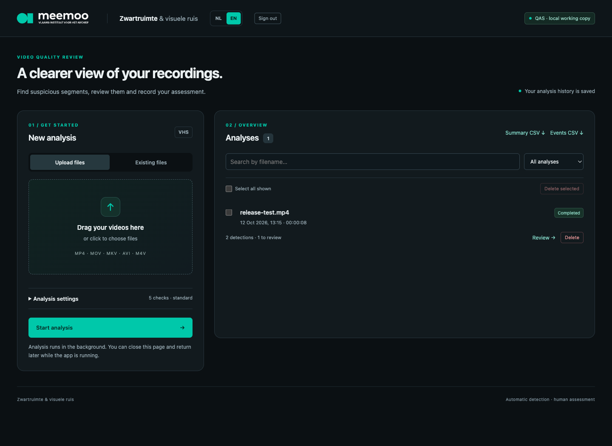

# VHS Quality Review

A web application for finding and reviewing potential defects in digitized VHS recordings. Automated checks flag suspicious segments; a reviewer watches them, records an assessment, and exports the results.

The interface is available in **Dutch and English**. This project is the updated review workflow for **Zwartruimte & visuele ruis**.



*Local preview using a generated test video.*

## Features

- **Five video and audio checks:** black frames, frozen frames, colour anomalies, grey noise or stripes, and sustained 1 kHz tones.
- **Background analysis queue:** upload several recordings, follow progress, cancel work, or retry an analysis.
- **Video review:** jump to flagged segments from the event table or timeline and mark them as a defect, not a defect, or still to review.
- **Saved history:** recordings, settings, results, and assessments survive application restarts when stored on a persistent disk.
- **Useful percentages:** upload progress, completed analysis steps, suspicious duration, and confirmed defect duration. Overlapping events count only once towards duration totals.
- **File management:** delete individual items or selected groups directly from the video library and analysis history.
- **CSV exports:** download event details or a summary of all analyses, including review decisions and precise timestamps.
- **NL / EN switch:** change the interface language; the browser remembers the selection.
- **Team access:** optional shared-password login locally, required for production hosting. Protected deployments require login for videos, history, and exports.

## What the checks look for

| Check | Signal |
| --- | --- |
| Black frames | Almost entirely dark frames |
| Frozen frames | Very little change between consecutive frames |
| Colour anomalies | Strong green or pink casts, or unusually high channel brightness |
| Grey noise / stripes | Low colour saturation combined with fine detail or vertical brightness differences |
| 1 kHz tone | Sustained audio energy concentrated around 1 kHz |

Detections are **review candidates**, not proof that a recording is damaged. Static shots, black frames, and monochrome footage may belong to the content. Minimum durations can be adjusted per analysis.

## Run locally

### Requirements

- Python 3.9–3.12; Python 3.11 is recommended for the pinned dependencies.
- FFmpeg and ffprobe available on `PATH`.
- macOS or Linux. The analysis queue uses Unix process groups and file locking.

From the project directory:

```sh
python3 -m venv .venv-run
.venv-run/bin/python -m pip install -r requirements.txt
.venv-run/bin/python -B web_app.py
```

Open **http://127.0.0.1:5009/**. On macOS, you can also double-click **Start App.command** after installing the dependencies.

Keep the application running while analyses are in progress. You may close the browser and return later. The local server listens on your computer's loopback interface and does not require a password by default.

## Review a recording

1. Upload one or more MP4, MOV, MKV, AVI, or M4V files. Videos placed manually in `uploads/` appear under **Existing files**.
2. Choose the checks and minimum durations, then start the analysis.
3. Open a completed analysis and use the video timeline or timestamps to inspect each flagged segment.
4. Select **Defect**, **Not a defect**, or **To review**. Assessments are saved immediately.
5. Export the event list or summary as CSV.

The upload percentage measures bytes transferred. The analysis percentage measures **completed steps**, not processed frames or estimated time remaining; different checks take different amounts of time.

Use the row-level delete buttons or select several items and choose **Delete selected**. Active analyses stop before deletion. Deleting a library video keeps its existing results but removes playback. Deleting an analysis removes its assessments; an uploaded source video is removed when its last associated analysis is deleted. The confirmation dialog explains what will be removed.

## Storage and team access

| Location | Contents |
| --- | --- |
| `data/history.sqlite3` | Analysis history, settings, events, and assessments |
| `data/media/` | New uploads with unique internal filenames |
| `data/logs/` | Technical logs for individual analyses |
| `data/.session-secret` | Signing key for browser sessions |
| `uploads/` | Optional existing video library |

These runtime files are excluded from Git. The repository contains source code, documentation, and a preview made with test data.

Set `APP_DATA_DIR` to choose another storage directory. Keep the database and its media together when making a backup. Local and hosted instances have separate histories; they do not synchronize automatically.

For shared-password access, generate a password hash with:

```sh
.venv-run/bin/python password_hash.py
```

Set the printed hash as the `APP_PASSWORD_HASH` environment variable. Keep the original password and hosting secrets outside the repository. Changing the hash invalidates existing logins.

## Optional hosting

The project includes a Gunicorn configuration, a Render build script, and a health endpoint at `/healthz`. See **[DEPLOYMENT.md](DEPLOYMENT.md)** for the setup, persistent storage, password protection, and release checks.

Creating this GitHub repository does not deploy an online instance. Production startup requires both `APP_PASSWORD_HASH` and `APP_DATA_DIR`. Use one application process and one service instance so that the queue and cancellation locks share the same state.

## Tests

With FFmpeg and the Python dependencies installed:

```sh
QAS_NO_RUNNER=1 .venv-run/bin/python -B -m unittest discover -s tests -v
```

The suite generates small temporary videos and isolated databases. It covers detection, cancellation, deletion, persistence, reviews, CSV exports, video byte ranges, language selection, and password protection. It does not use your recordings or analysis history.

## Limitations

- Colour and noise checks are heuristic and can produce false positives. Absence of detections does not guarantee a recording is defect-free.
- Grey-noise detection samples approximately two frames per second. The tone check uses 0.25-second windows and the first audio track; videos without audio skip that check with a warning.
- Browser playback depends on the original codec. Some MOV, AVI, or MKV files may need to be downloaded and opened in a desktop player. The app does not transcode them automatically.
- Only one recording is analysed at a time. Interrupted work can be retried; queued work resumes after startup.

## License and origin

Released under the [MIT License](LICENSE.md). This updated application builds on [Zwartruimte & visuele ruis](https://github.com/9elmaz9/zwartruimte-visueleruis-app) and retains its existing license notice and visual identity.
